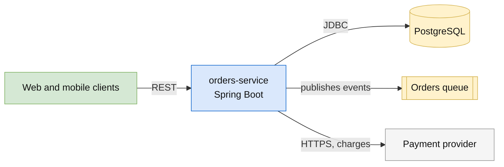

# C4 Context diagram

Answers one question: who calls this system, and what does it call out to. System boundary only. Internals belong to `component-diagram`, call order over time belongs to `sequence-diagram`.

## Method

1. Trace dependencies from code, never from the service name. Look for HTTP and gRPC clients, database and search repositories, queue producers and consumers, cache clients, object storage, and vendor SDKs. Check config files and infrastructure manifests for hosts and queue names.
2. Find callers in the repository docs, gateway and route config, and API specs. If callers are unknown, say so in the legend instead of guessing.
3. One node per real system. Name nodes as they appear in code or config.
4. Group three or more near identical callers into one node, for example `Web and mobile clients`.
5. One edge per target, labelled with the protocol and intent, for example `REST, reads prices`.
6. Add a one or two sentence legend as a Mermaid `note` node or as text under the diagram. Say the thing a reader would otherwise miss, such as sync mechanism or the single admin only external call.

## Template

````markdown

````

Node shapes: rectangle for systems, `[( )]` for datastores, `[[ ]]` for queues. Classes: `sys` this system, `caller` inbound, `ext` third party, `infra` managed infrastructure.

## Rules

- Flat layout, callers left, this system centre, dependencies right.
- No internal controllers, services or mappers.
- No edge for something the code does not do, and no placeholder box for a dependency you could not confirm.
- Reuse the classes above so every diagram in a repo looks the same.

## Output

Write the diagram into the file the caller names. Default `docs/architecture/c4-context.md` with a title, the fenced diagram and the legend. GitHub renders Mermaid in Markdown and in wikis.

## Verify

- Every node maps to a client, repository, config entry or documented caller you can point at.
- No edge crosses an unrelated node.
- The diagram renders in a GitHub preview.
