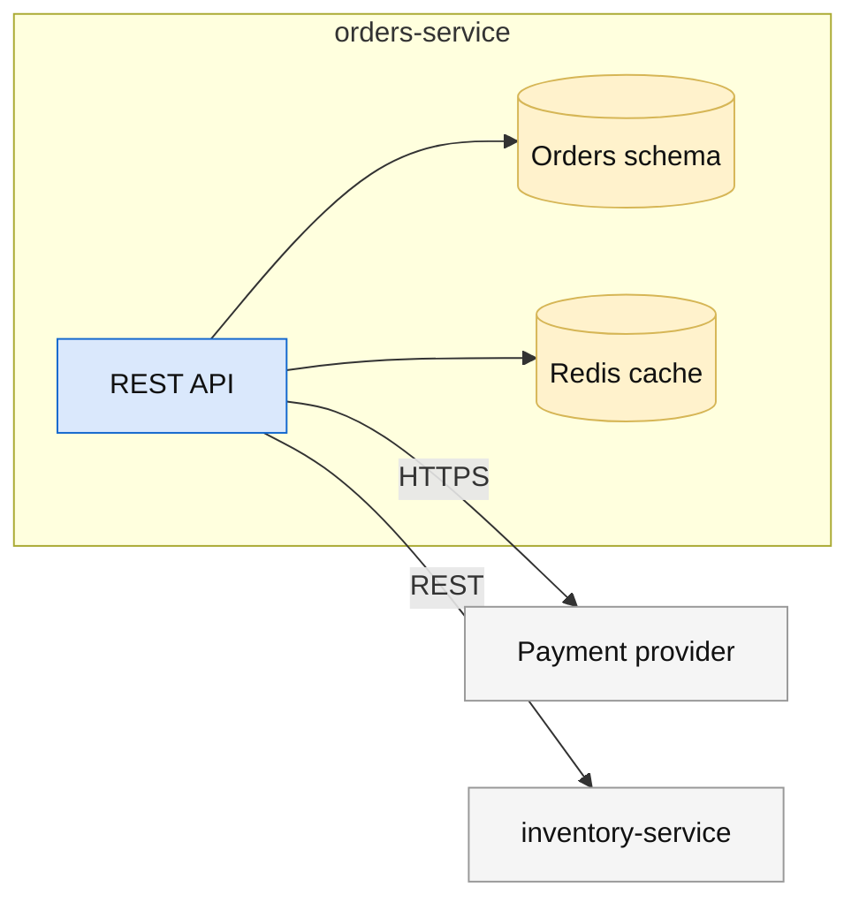

# Component diagram

One level inside the Context diagram. Shows the service, what it owns (datastore, cache, queue, index) and what it calls. One level deep: no classes, controllers or mappers.

## Method

1. Start from the dependency list of the Context diagram. Reuse it, do not re-derive it differently.
2. Add one node per owned piece of infrastructure, confirmed by a repository, client, migration or config entry. Shared infrastructure owned by another team is a dependency, not an owned component.
3. Draw the service as a `subgraph` boundary containing its owned infrastructure. Outbound dependencies sit outside the boundary.
4. Collapse repeated calls to the same target into one arrow. Distinct call sites belong in sequence diagrams.
5. Leave inbound callers out. The Context diagram already shows them.

## Template

````markdown

````

Keep `own` for the service and its parts, `infra` for owned infrastructure, `ext` for everything outside the boundary. Same palette as `c4-context-diagram`.

## Rules

- At most one arrow between any two nodes.
- Every node traces to code or config. No inferred components.
- Stop at the service level. If a reader needs the order of calls, point to a sequence diagram instead.

## Output

Write into the file the caller names. Default `docs/architecture/components.md` with a title and the fenced diagram. GitHub renders Mermaid in Markdown and in wikis.

## Verify

- No node pair has more than one edge.
- Each owned infrastructure node is backed by a real repository, client or config entry.
- The diagram renders in a GitHub preview.
