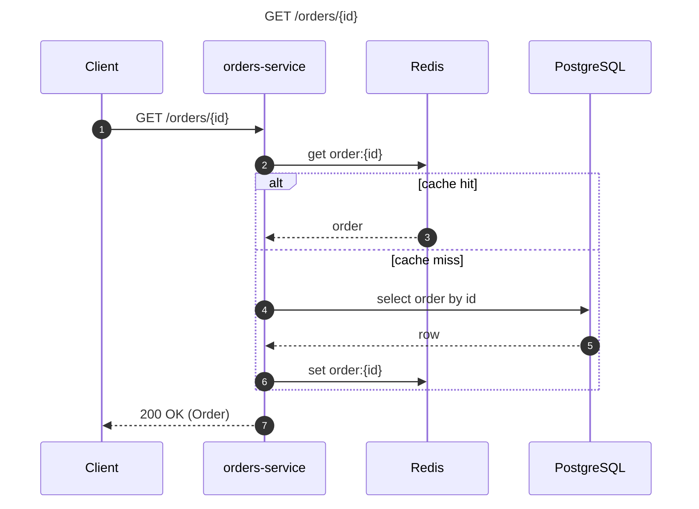

# Sequence diagram

One diagram per operation: an HTTP endpoint, a message consumer or a scheduled job. Never mix unrelated flows in one diagram.

## Method

1. Find the entry point (controller method, listener, scheduler) and follow it through the service layer to every external call. Do not infer a call from a method name.
2. List participants in call order. Name them as they exist: the caller, this service, then each real dependency such as a database, cache, queue or vendor API.
3. Draw what the code does: requests with `->>`, responses with `-->>`, fire and forget with `-)`. Use `alt`, `opt` and `loop` only for branches and loops that exist in the code, such as cache hit versus miss or retry.
4. Title it with the operation: `GET /orders/{id}` for HTTP, `Async: order paid (queue consumer)` for events.
5. Add `autonumber` when the flow has more than five messages.

## Template

````markdown

````

## Rules

- Error paths only when the code handles them distinctly, for example a 404 mapping.
- Do not list endpoints that are not implemented, and do not add placeholder or history entries.
- No decorative boxes or styling. Mermaid defaults render correctly in light and dark themes.
- Participant labels are real component names, never `Service A`.

## Output

Write into the file the caller names, one fenced diagram per operation under a heading with the same title. Default `docs/architecture/sequences.md`. GitHub renders Mermaid in Markdown and in wikis.

## Verify

- Each message corresponds to a call you traced in code.
- Branches in the diagram match branches in the code.
- The diagram renders in a GitHub preview.
